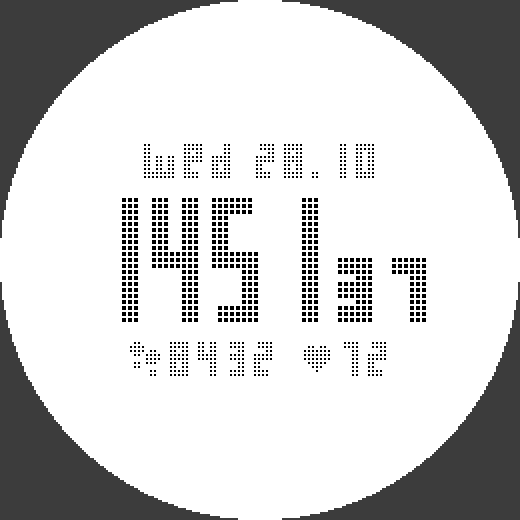

# Suunto Like — циферблат для Garmin Fenix 6

Циферблат в стиле Suunto Core: точечные сегментные цифры, белый фон, чёрные данные.



На экране: день недели и дата, время с секундами, шаги и пульс, 12 рисок по краю.

## Запуск в симуляторе

1. Открой папку репозитория в VS Code (нужно расширение Monkey C и Connect IQ SDK).
2. `Ctrl+Shift+P` → **Monkey C: Build for Device** или **Run** → выбери `fenix6`.
3. Если VS Code просит ключ разработчика: `Ctrl+Shift+P` → **Monkey C: Generate a Developer Key**.

## Структура

```
manifest.xml             описание приложения (тип watchface, устройства)
monkey.jungle            конфигурация сборки
source/
  SuuntoLikeApp.mc       точка входа
  SuuntoLikeView.mc      отрисовка циферблата
resources/
  fonts/                 точечные шрифты (.fnt + .png), генерируются скриптом
  drawables/             иконка приложения
  strings/               строки
tools/
  dotfont.py             описание шрифтов: сетка, сегменты, буквы, иконки
  gen_fonts.py           генерирует шрифты и иконку в resources/
  preview.py             рисует docs/preview.png
```

## Как поменять шрифты

Размеры символов, толщина сегментов и размер квадратиков задаются в `tools/dotfont.py`.
После изменений:

```
pip install pillow
python3 tools/gen_fonts.py   # пересобрать шрифты
python3 tools/preview.py     # посмотреть превью
```

Если меняешь `gap` или `cell`, поправь `GAP_PX` / `GAP_SMALL_PX` в `source/SuuntoLikeView.mc` (это `gap * cell`).
